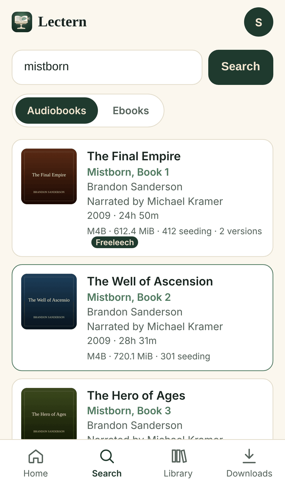
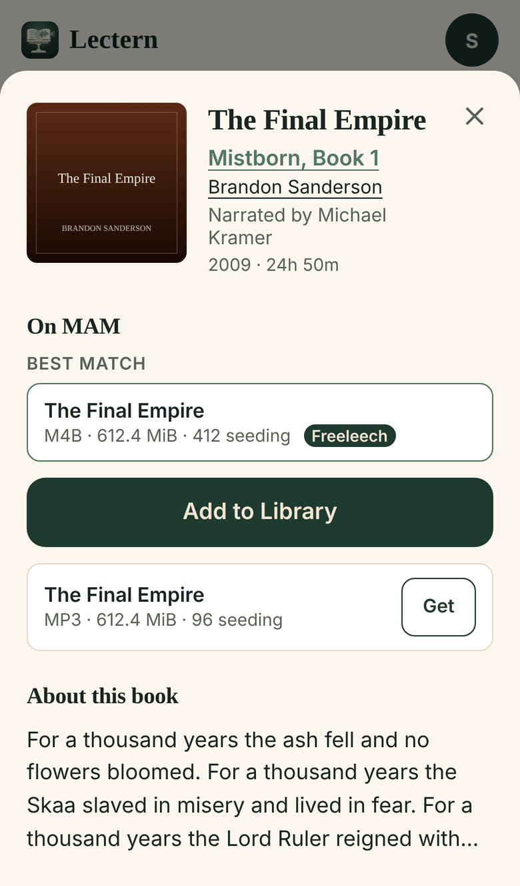
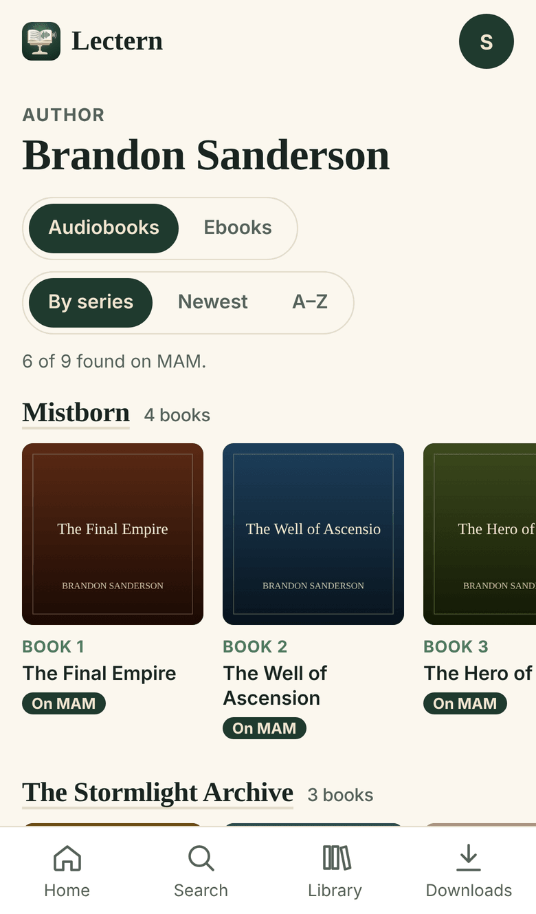
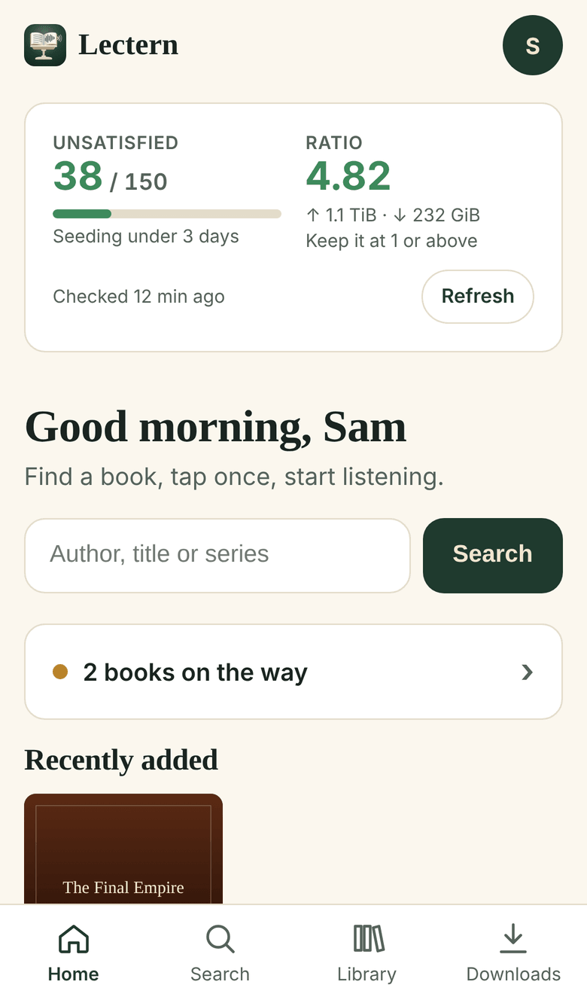
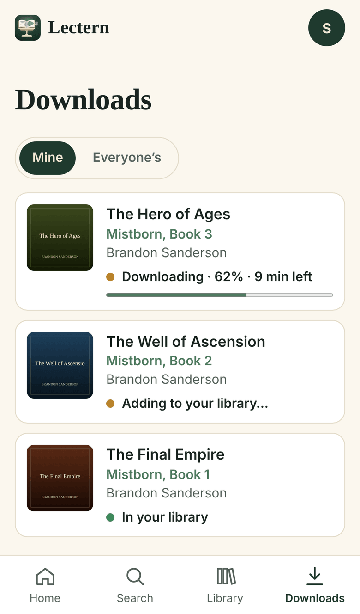
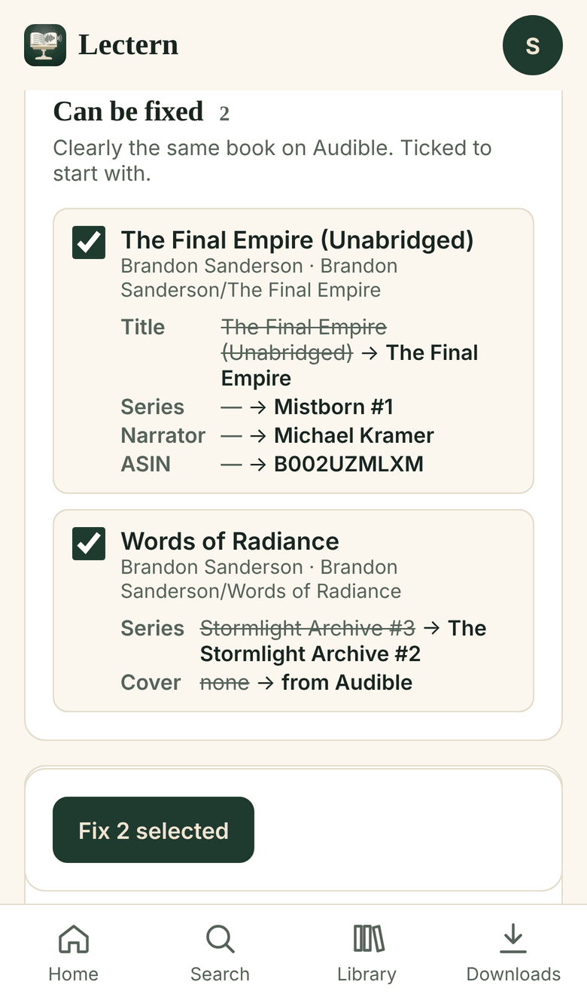
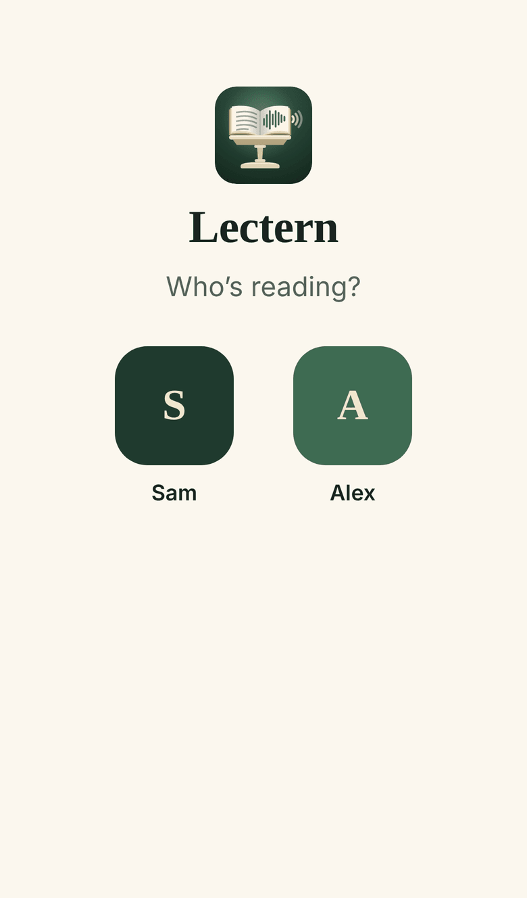

<p align="center">
  
</p>

<h1 align="center">Lectern</h1>

<p align="center">
  <b>Search on your phone, tap once, and the book shows up correctly in your library.</b><br />
  A self-hosted app for MyAnonamouse, qBittorrent and Audiobookshelf.
</p>

<p align="center">
  
  
  
</p>

## What it does

- **Searches MAM directly.** One search, results grouped by book (m4b, mp3 and re-uploads
  become one entry, best version first). Only things MAM actually has are listed.
- **Adds a book in one tap.** Lectern fetches the torrent, hands it to qBittorrent, watches it
  finish, and files it into your library as `Author/Series/Book N - Title/`, with a
  `metadata.json`, the cover, and the right series and book number. Audiobookshelf is told to
  scan, so it appears straight away.
- **Hardlinks, so seeding keeps working.** No second copy, no extra space.
- **Author and series pages** in reading order, with one tap to check which books MAM has.
- **Profiles.** Each person signs in and gets their own audiobook and ebook libraries, their
  own qBittorrent category and their own book language.
- **Tidy up** (admins): checks an existing Audiobookshelf library against Audible and fixes
  titles, series and book numbers, narrators and missing covers. You pick what to fix, and
  every run can be undone.
- **Your MAM account at a glance:** ratio and unsatisfied torrents on the home screen.
- **Installs like an app** on your phone (Add to Home Screen).

<p align="center">
  
  
  
  
</p>

## How Lectern treats MAM

Lectern only uses what MAM's API page allows to be automated, and only when you ask:

| When | What Lectern sends |
|---|---|
| You press **Search** | One torrent search (answers are kept for 3 hours, so repeats cost nothing) |
| You press **Check what's on MAM** on an author or series page | One torrent search for the whole page |
| You open a book from an author or series page without checking first | Up to 3 searches for that book, stopping at the first strong match |
| You press **Add to Library** | One `.torrent` download, with your session cookie. **Never** a freeleech wedge |
| Once an hour | Your own account summary (ratio and unsatisfied count) |

Nothing is sent while you type or when a page opens. Requests go one at a time, at least
2 seconds apart, with a cap of 150 searches a day. Lectern keeps MAM's refreshed session
cookie so your session doesn't expire. If your session is locked to a VPN, Lectern can refuse
to contact MAM unless the VPN is up (see [Using a VPN](#using-a-vpn)).

Lectern isn't affiliated with MyAnonamouse. Check MAM's rules on automated tools yourself
before using it.

## Setup

### What you need

- Docker (and Docker Compose)
- qBittorrent with the Web UI on (version 5.2 or newer lets Lectern use an API key)
- Audiobookshelf (optional, but it's where your books end up)
- A MyAnonamouse account

### 1. Put downloads and libraries under one folder

This is the one rule that matters. Lectern hardlinks finished books from the download folder
into your library, and **hardlinks only work when both are on the same drive and Lectern sees
them through one shared mount.**

```
/mnt/media/               ← one folder on the host, mounted as /media in every container
├── torrents/             ← qBittorrent saves here
├── audiobooks/           ← an Audiobookshelf library
└── ebooks/               ← another (optional)
```

Mount `/mnt/media` once (`-v /mnt/media:/media`), not `torrents` and `audiobooks` separately:
two separate mounts look like two drives to Lectern, even on the same disk. If hardlinks
can't work, Lectern copies instead and tells you in **Settings → Profiles**.

### 2. Start Lectern

Copy [`docker-compose.example.yml`](docker-compose.example.yml) (Lectern, qBittorrent and
Audiobookshelf) and [`.env.example`](.env.example), or add just the Lectern service to your own
compose file:

```yaml
services:
  lectern:
    image: ghcr.io/fenrexe/lectern:latest
    container_name: lectern
    restart: unless-stopped
    ports:
      - "8787:8787"
    environment:
      PUID: 1000        # the user that owns your library folders (`id` on the host)
      PGID: 1000
      TZ: Etc/UTC
    volumes:
      - ./lectern:/data       # Lectern's database and cover cache
      - /mnt/media:/media     # downloads AND libraries, one mount
```

```
docker compose up -d lectern
docker logs lectern       # look for: "enter the setup code ABCD-EFGH"
```

### 3. Create the admin profile

Open `http://<your-server>:8787`, enter the setup code from the log, and pick a name and
password. The setup code stops strangers from claiming a fresh install.

### 4. Connect everything (Settings → Connections)

Each section has a **Test connection** button.

- **MyAnonamouse.** In MAM, go to *Preferences → Security*, create a session for Lectern, and
  paste its `mam_id` value. Lock it to the IP (or ASN) that Lectern's traffic comes from.
- **qBittorrent.** Its Web UI address as Lectern sees it (`http://qbittorrent:8080` in the
  example compose file). On 5.2 or newer, generate an API key under *Options → Web UI* and paste
  it; otherwise use the username and password. **Save downloads to** is qBittorrent's path for
  your torrents folder (`/media/torrents`).
- **Audiobookshelf.** `http://audiobookshelf:80` and an API key from an **admin** account
  (*Settings → API Keys* in Audiobookshelf), so Lectern can see every library.
- **Book information.** Works without setup. A free
  [Google Books API key](https://developers.google.com/books/docs/v1/using#APIKey) helps
  with ebooks, because Google's shared limit runs out often.

### 5. Set up profiles (Settings → Profiles)

For each person, pick the folder their audiobooks (and ebooks) go into, and the
Audiobookshelf library to scan. Under each folder Lectern shows whether books will be
**hardlinked** or **copied**. Add a profile for everyone else; members can search and add books,
admins can also change settings.

Each person also picks a **book language** under *Settings → You* (English by default, or
any), and search, author and series pages hide other languages.

### 6. On your phone

Open Lectern in the browser and use *Add to Home Screen*.

## Using a VPN

Only needed if your MAM session is locked to a VPN's IP or network. Lectern then shares the
network of a qBittorrent container that has the VPN built in (or Gluetun), so all of its MAM
traffic leaves through the tunnel. See
[`docker-compose.vpn.example.yml`](docker-compose.vpn.example.yml). The differences:

- Lectern has `network_mode: "service:qbittorrent"` and no ports of its own; port 8787 is
  published on the VPN container, and qBittorrent is at `http://localhost:8080`.
- Set `MAM_REQUIRE_INTERFACE=wg0` (or `tun0`, whatever your VPN creates). Lectern then
  refuses to contact MAM while the tunnel is down, so your home IP is never used by accident.
  It can only be set in the environment, not in the app.
- Container names may not resolve inside the VPN, because DNS goes through it. Reach
  Audiobookshelf by the Docker network's gateway and its published port instead, for example
  `http://172.19.0.1:13378` (`docker network inspect` shows the gateway).

## More

<details>
<summary><b>Tidy up an existing library</b></summary>

*Settings → Tidy up* (admins). Pick a library and press **Scan**, which changes nothing.
Lectern looks up every book on Audible, by its ASIN when it has one, otherwise by title and author,
and sorts them into *can be fixed* (ticked), *need a look* (unticked, with the reason),
*already right* and *not found*. Each book shows its changes, such as
"Series: — → Mistborn #1". **Fix selected** changes only the ticked books through
Audiobookshelf's API, and **Undo this run** puts them back.

It fixes details only. It never moves or renames files, never blanks a field, and never
replaces a cover or year a book already has. Make an Audiobookshelf backup before your first run anyway.
</details>

<details>
<summary><b>Settings in the environment</b></summary>

Almost everything is set in the app. The environment is for things that belong to how
Lectern is deployed: `PUID`, `PGID`, `TZ`, `MAM_REQUIRE_INTERFACE`, `TRUST_PROXY` (behind a
reverse proxy: the proxy's address, or `true`), `PORT` and `LOG_LEVEL`. Connection settings
(`MAM_ID`, `QB_URL`, `QB_API_KEY`, `ABS_URL`...) can also go here as defaults; anything saved
in the app wins. See [`.env.example`](.env.example).

If qBittorrent and Lectern see the downloads under different paths, set **qBittorrent's path**
and **Lectern's path** under *Connections → qBittorrent → Different paths for downloads*.
Matching paths are simpler.
</details>

<details>
<summary><b>Security</b></summary>

Passwords are hashed (scrypt), sessions are stored only as hashes, sign-in attempts are
rate-limited, and every change must come from Lectern's own page. Saved secrets (MAM cookie,
API keys) stay in Lectern's database in your data folder and are never shown again in full.
If Lectern can be reached from outside your home, turn off *Show profile names on the sign-in
page* (Settings → Profiles) and put it behind HTTPS.
</details>

<details>
<summary><b>Troubleshooting</b></summary>

- **"Copied rather than hardlinked"**: the downloads and library are on different drives, or
  mounted separately. See step 1.
- **"Lectern isn't allowed to write to…"**: set `PUID`/`PGID` to the owner of your library
  folders (`ls -ln /mnt/media`).
- **"MAM rejected the session"**: create a new session in MAM and paste the new `mam_id` in
  Settings → Connections. Check it's locked to the IP Lectern actually uses.
- **"The VPN (wg0) isn't up"**: the VPN check is on and the tunnel is down. Check the
  qBittorrent container's logs.
- **Books don't show in Audiobookshelf**: pick the Audiobookshelf library for that profile in
  Settings → Profiles, and check that the API key belongs to an admin.
</details>

<details>
<summary><b>Updating and backups</b></summary>

`docker compose pull lectern && docker compose up -d lectern`. Everything Lectern keeps is in
its data folder (`./lectern` above); back that up. The database upgrades itself on start.
</details>

<details>
<summary><b>Development</b></summary>

TypeScript everywhere: a Fastify server, a Vue 3 web app, and SQLite. Node 22+.

```
npm install
npm run dev          # server on :8787, web app on http://localhost:5173
npm test             # unit tests
npm run typecheck
npm run build
docker build -t lectern .
```

[`CLAUDE.md`](CLAUDE.md) has the rules the code follows (especially around MAM), and
[`docs/DESIGN.md`](docs/DESIGN.md) the product design.
</details>

## About

Heavy vibe coding with claude on this one because i hated the options out there and had to keep fixing issues with them.

## Licence

[GPL-3.0-or-later](LICENSE). You can use, change and share Lectern; if you share a changed
version, share its source too.
